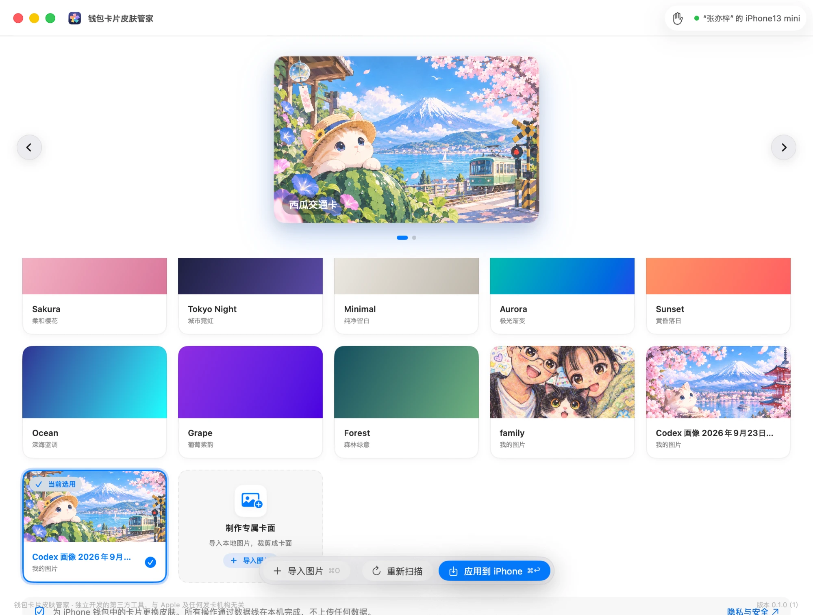

<div align="center">


# ウォレットカードスキン管理

**Apple ウォレットのカードを、好きなデザインに**

ケーブルで iPhone をつなぎ、ウォレット内の銀行カードや交通系カードのカード面を着せ替えできる macOS ツールです。サンプルスキンを内蔵していますが、自分の画像を取り込んでオリジナルのカード面を作るのがおすすめです。

[](https://github.com/zhanggenlove/WalletCardSkin/releases)
[](https://github.com/zhanggenlove/WalletCardSkin/releases)
[](LICENSE)


[简体中文](README.md) · [English](README.en.md) · **日本語**

</div>

---

> 個人開発のサードパーティ製ツールであり、Apple および銀行・カード発行会社・カードブランドとは一切関係ありません。
> **カード面の表示画像を変更するだけです。決済情報には一切触れず、データを送信せず、タッチ決済にも影響しません。**

## プレビュー

<div align="center">

</div>

<div align="center">
<table>
<tr>
<td align="center"><br/>iPhone のカード詳細</td>
<td align="center"><br/>ウォレット内のオリジナルカード面</td>
</tr>
</table>
</div>

## ✨ 特長

- 🎴 **ワンタップ着せ替え**：ウォレットのカードをスキャンし、スキンを選んで iPhone に適用。
- 🖼️ **オリジナルカード面**：自分の画像を取り込み、ドラッグ・ズームでカードに切り抜き。
- 🎨 **サンプル内蔵**：すぐ使えるサンプルスキンを同梱。
- 🔒 **ローカル & プライバシー**：すべてケーブル経由でローカル処理。アップロードせず、決済情報にも触れません。
- 🖥️ **ネイティブ体験**：SwiftUI 製で macOS に馴染むデザイン。Apple Silicon と Intel 両対応のユニバーサルバイナリで、**Python のインストール不要**。

## 📦 インストール

1. [Releases](https://github.com/zhanggenlove/WalletCardSkin/releases) から最新の `WalletCardSkin.app.zip` をダウンロードして解凍します。
2. `钱包卡片皮肤管家.app` を「アプリケーション」フォルダへドラッグします。
3. 本アプリは Apple の公証を受けていないため、初回起動時に Gatekeeper にブロックされます。下記いずれかの方法で許可してください。

### ブロックされたアプリを許可する（Gatekeeper）

**方法 1 ・ 隔離属性を外す（推奨）** — 「ターミナル」で実行（パスは適宜変更）：

```bash
xattr -dr com.apple.quarantine "/Applications/钱包卡片皮肤管家.app"
```

**方法 2 ・ 右クリックで開く** — アプリを右クリック →「開く」→ ダイアログで再度「開く」。

**方法 3 ・ システム設定** — ブロック後、「システム設定 →『プライバシーとセキュリティ』」の下部で「このまま開く」。

> これは公証（有料）を行っていないためで、危険という意味ではありません。ソースは完全公開されており、確認・ビルドできます。

## 🚀 使い方

1. ケーブルで iPhone を Mac に接続し、iPhone で「このコンピュータを信頼」をタップします。
2. iPhone の「ウォレット」アプリを開きます（サイドボタンを 2 回押しても可）。
3. アプリで「スキャン開始」をクリック。カードが見つかるとメイン画面に入ります。
4. スキンを選ぶか、「オリジナルを作成」で自分の画像を取り込んで切り抜きます。
5. 「iPhone に適用」をクリック。完了後は **ウォレットアプリをバックグラウンドから終了して開き直す** と新しいカード面が表示されます（古いままなら iPhone を再起動）。

**動作環境**：macOS 14 以降 / iPhone は iOS 18 以降（iOS 27 で確認済み）。

## ⚠️ 注意

- **元のカード面はアプリ内で復元できません。** バックアップは行いません。戻すにはウォレットでカードを削除して再追加してください（発行会社の再認証が必要な場合があります）。
- iOS のアップデートやウォレットの再同期で、カード面が元に戻ることがあります。
- 利用は自己責任でご判断ください。アプリ内「ヘルプ → 免責事項」も参照してください。

## 🛠️ ソースからビルド

```bash
git clone https://github.com/zhanggenlove/WalletCardSkin.git
cd WalletCardSkin
swift build        # ビルド
swift test         # テスト
```

デバイス通信は [AirCard](https://github.com/) の補助プログラム（`device_helper`、`airtraffic_host`）と Python バックエンドに依存します。実機対応アプリをパッケージ化するには：

```bash
AIR_CARD_ROOT=/path/to/AirCard-main scripts/package_app.sh
```

スクリプトは release をビルドし、Sparkle とアプリアイコンを埋め込み、スタンドアロン Python ランタイム（[python-build-standalone](https://github.com/astral-sh/python-build-standalone)、arm64 + x86_64）をダウンロードして同梱します。そのため対象 Mac に python3 は不要です。Apple Silicon のみなら `WB_PYTHON_ARCHS=arm64 scripts/package_app.sh` でサイズを削減できます。

`Resources/BuiltInSkins/` に画像を置くと、内蔵サンプルスキンとして表示されます。構成やロードマップは `docs/` を参照してください。

## 🔍 仕組み

本アプリ自体はプライベートフレームワークを一切リンクしません。デバイス通信はすべて AirCard の補助プログラムに封じ込め、アプリは検証済みの境界のみを呼び出します：

```text
カード素材を生成 → AirCard 経由でデバイスへ書き込み → ウォレットのキャッシュを更新
```

カード検出とスキン同期はすべてケーブル経由でローカルに行われます。オンライン通信はアップデート確認（Sparkle）のみで、カードやデバイスの情報は送信しません。

## 🙏 謝辞とライセンス

本プロジェクトは [MIT ライセンス](LICENSE) で公開しています。

- デバイス通信：[AirCard](https://github.com/)（MIT, © 2026 Johnny Franks）
- 自動アップデート：[Sparkle](https://github.com/sparkle-project/Sparkle)
- 内蔵 Python：[python-build-standalone](https://github.com/astral-sh/python-build-standalone)

第三者コンポーネントのライセンス全文は [THIRD_PARTY_NOTICES.md](THIRD_PARTY_NOTICES.md) にあります。
